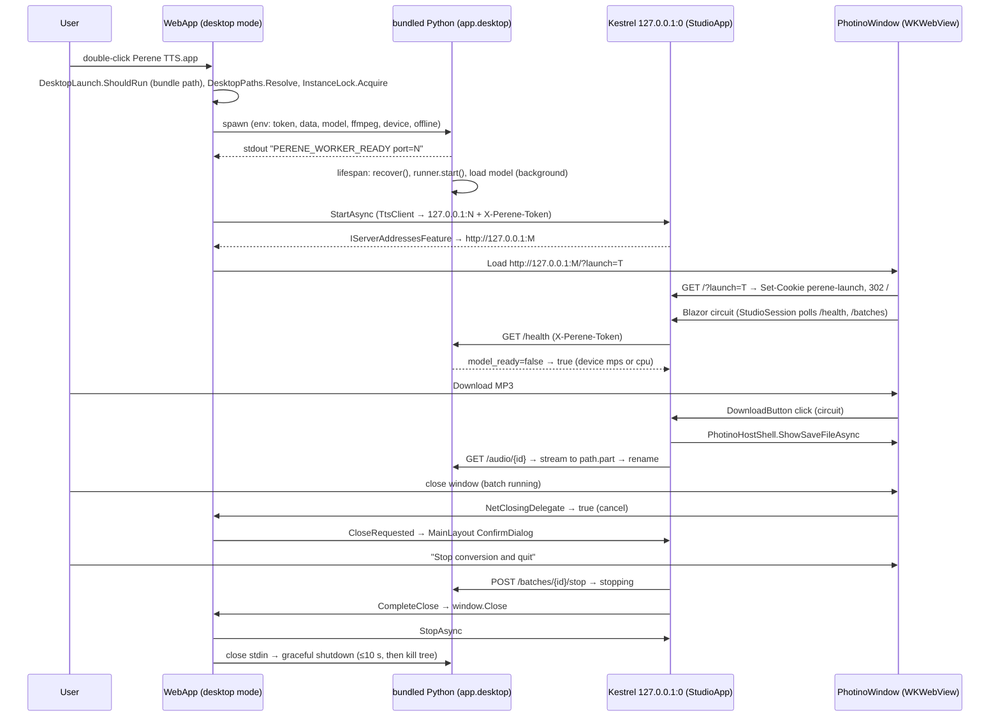

# Plan: macOS Desktop App (Offline, Ad-hoc Signed .app)

## Table of Contents
- [Summary](#summary)
- [Technical Approach](#technical-approach)
  - [Delivery phases and gates](#delivery-phases-and-gates)
  - [Process model](#process-model)
  - [Worker changes](#worker-changes)
  - [Desktop host in WebApp](#desktop-host-in-webapp)
  - [Shell abstraction and UI changes](#shell-abstraction-and-ui-changes)
  - [Closing the window](#closing-the-window)
  - [Directories, logs, and single instance](#directories-logs-and-single-instance)
  - [Packaging the .app and zip (in Docker)](#packaging-the-app-and-zip-in-docker)
  - [Signing and sharing without a paid account](#signing-and-sharing-without-a-paid-account)
  - [Icon](#icon)
  - [Design principles applied](#design-principles-applied)
  - [Implementation notes (2026-10-12)](#implementation-notes-2026-10-12)
- [Component Breakdown](#component-breakdown)
- [Dependencies](#dependencies)
- [External / Vendor Documentation Evidence](#external--vendor-documentation-evidence)
- [Flow](#flow)
- [Risk Assessment](#risk-assessment)

## Summary
Desktop mode is a second host mode of the existing `WebApp`. It starts from inside `Perene TTS.app` (or with `--desktop`) and does four things:
- locks a single instance
- launches the bundled FastAPI worker (a standalone Python running `app.desktop`) as a loopback sidecar protected by a per-launch token
- runs the unchanged Blazor Interactive Server UI on a random loopback port
- shows the UI in a Photino window, which uses the system WKWebView.

Everything (the .NET runtime, worker, model weights and FFmpeg) ships in one ad-hoc signed `.app`, built entirely inside Docker by `make desktop-mac` and zipped for friends. Nothing is installed on the Mac. The Docker and `mac-*` workflows keep their current composition through a shared `StudioApp` registration.

Compared with the earlier Linux AppImage version of this plan, the worker and host work is the same. The bundled WebKitGTK and its spike gate are gone, because macOS provides WKWebView. The new work is the native build script, Mach-O compatibility checks and ad-hoc signing.

## Technical Approach

### Delivery phases and gates
1. **Phase 1: spikes on the Mac. Gates; nothing is merged into the product before they pass.**
   - **1a. Window and lifecycle.** Build a throwaway `packaging/macos/spike/` app: a self-contained `net10.0` `osx-arm64` console app with Photino.NET 4.0.16 and an in-process Kestrel on `127.0.0.1:0`, wrapped in an ad-hoc signed `.app`. On this Mac it must:
     - load `http://127.0.0.1:<port>` in WKWebView (App Transport Security with `NSAllowsLocalNetworking`)
     - set and send a SameSite=Strict, HttpOnly cookie from `/?launch=<token>`
     - play an MP3 through `<audio>` (the existing `AudioPlayer.razor` path)
     - open the native save, open-file and open-folder dialogs
     - cancel a close through `RegisterWindowClosingHandler` for the red button and ⌘W, and **record whether ⌘Q and Dock → Quit go through the same handler**
     - show a native alert before any window exists (for "already running" and worker errors)
     - not trigger a macOS firewall prompt for loopback-only listeners.

     Also record `file libPhotino.Native.dylib` (it must be arm64). **If ⌘Q bypasses the handler, stop and ask the user about the fallback** (Open Questions).
   - **1b. Worker, signing and sharing.** Build the app with `make desktop-mac` (Docker) and copy it to the Mac. Check it with `codesign --verify --deep --strict`. Then:
     - run FR23's smoke script with outbound network denied, on `cpu` and on `mps`, and record bundle size, cold start, time to `model_ready`, speech speed and peak RSS for each
     - run the Mach-O compatibility check (FR18)
     - copy the app with `ditto`, add a quarantine attribute as a download would, open it, approve **Open Anyway**, and confirm the worker and FFmpeg subprocesses start.

     If a friend's Mac is available, repeat the quarantine test there. **If subprocesses are blocked after Open Anyway, stop and ask the user** whether the README may require `xattr -dr com.apple.quarantine` instead.
2. **Phase 2: worker changes** (FR1–FR6) with pytest. Can run on any machine through `make test`.
3. **Phase 3: desktop host and UI** (FR7–FR16) with xUnit. Can run on any machine through `make test`, with the window checked on the Mac.
4. **Phase 4: packaging, docs, manual verification on the Mac** (FR17–FR25), plus a friend's Mac when available.

### Process model
```
Perene TTS.app (read-only, ad-hoc signed)
└─ Contents/MacOS/WebApp  (CFBundleExecutable; desktop mode detected from the bundle path)
   ├─ InstanceLock          ~/Library/Application Support/Perene TTS/instance.lock
   ├─ WorkerProcess ─ spawn Contents/Resources/python/bin/python3.11 -I -X pycache_prefix=<Caches> -m app.desktop   (stdin pipe kept open)
   │      env: TTS_API_TOKEN, TTS_DATA_DIR, TTS_MODEL_DIR, TTS_FFMPEG, TTS_DEVICE,
   │           PYTORCH_ENABLE_MPS_FALLBACK=1, HF_HUB_OFFLINE=1, TRANSFORMERS_OFFLINE=1,
   │           HF_HOME, NUMBA_CACHE_DIR
   │      stdout line 1 → "PERENE_WORKER_READY port=41873" ; rest → ~/Library/Logs/Perene TTS/worker.log
   ├─ Kestrel 127.0.0.1:0  (StudioApp services + endpoints, AllowedHosts=127.0.0.1, launch cookie)
   └─ PhotinoWindow (WKWebView) → http://127.0.0.1:<web-port>/?launch=<token>   (main thread, WaitForClose)
```
There is still exactly one worker process and one batch runner thread, as AGENTS.md requires. The worker HTTP API, `TtsClient` and every Razor page stay the same. Only the base address, a header, and a few download and picker controls change in desktop mode.

### Worker changes
- **`app/desktop.py` (new; the bundled Python runs it as `-m app.desktop`):**
  1. Create the socket (`socket.create_server(("127.0.0.1", 0))`) and print `PERENE_WORKER_READY port=<n>` with flush. The socket already accepts connections into its backlog, so the host may connect before Uvicorn's loop runs.
  2. Start a daemon thread that reads `sys.stdin.buffer` until EOF and then sets `server.should_exit = True`.
  3. Run `uvicorn.Server(uvicorn.Config(app.main.app, workers=1, log_config=…)).run(sockets=[sock])`.

  Startup ordering (`desktop_main(stdin, stdout, server_factory)`) is a small function, so tests can drive it with fakes. Docker and `mac-worker` keep their current commands and never import this module. At startup it logs the names (never the values) of the desktop settings it received.
- **`app/main.py`:**
  - Add `ApiToken`, an ASGI middleware written like the existing `RequestSizeLimit`. It is registered in `create_app()` only when `TTS_API_TOKEN` is non-empty, compares with `hmac.compare_digest`, and returns `JSONResponse(401, {"detail": "Unauthorized"})`.
  - `lifespan` passes `model_dir=Path(os.environ["TTS_MODEL_DIR"])`, when set, to `ChatterboxEngine`.
  - Device selection is unchanged: the existing `select_device` already handles `auto`, `cpu` and `mps`. The device is not part of the batch checkpoint identity, and conditioning loads with `map_location`, so either device works with the same data.
- **`app/engine.py`:**
  - `ChatterboxEngine.__init__` gains `model_dir: Path | None = None`.
  - In `load()`, the `multilingual-v3` branch uses `checkpoint_dir = verify_bundled_model(model_dir, model_revision)` instead of `snapshot_download` when `model_dir` is set.
  - `verify_bundled_model` is new and pure. It reads `model-manifest.json` (`{"repository","revision","files":{name:{"size","sha256"}}}`) and checks the repository, the revision and every file in `MODEL_FILES` by existence and size. It never hashes 3 GB at startup; SHA-256 is verified once at build time.
  - Failures raise `SynthesisError("The bundled voice model is missing or damaged. Reinstall Perene TTS.")`. The existing `_load_error` path surfaces this through `/health`.
- **`app/studio.py`:** `ffmpeg()` uses `os.getenv("TTS_FFMPEG", "ffmpeg")` as argv[0]. Nothing else changes, so encode settings and validation stay identical.
- **Bundled FFmpeg:** a pinned FFmpeg release cross-compiled in the builder with zig (`zig cc -target aarch64-macos.14.0`, no Apple SDK needed), `--enable-cross-compile --target-os=darwin --arch=aarch64 --disable-asm --enable-pthreads`, `--disable-autodetect` (so it never picks up AudioToolbox, VideoToolbox or Homebrew libraries), `--disable-everything --disable-gpl --enable-libmp3lame` and a static LAME built with the same deployment target. It enables only:
  - decoders `mp3*`, `pcm_*`
  - demuxers `mp3`, `wav`
  - encoders `libmp3lame`, `pcm_s16le`
  - muxers `mp3`, `wav`
  - parser `mpegaudio`
  - filters `aresample`, `aformat`, `anull`, `abuffer`, `abuffersink`
  - protocols `file`, `pipe`.

  It must link only `/usr/lib/libSystem`. A macOS binary cannot run in the Linux builder, so `make desktop-smoke` on the Mac exercises the decode and encode commands in `studio.py`. The result is LGPL-2.1+ with its license texts and a source pointer. **Fallback:** if a needed component is missing, add it to the configure list. Never use a GPL or Homebrew build without recording the license change.

### Desktop host in WebApp
Desktop mode stays inside `WebApp` rather than a new project. There is one composition root and the static web assets pipeline is unchanged (`MapStaticAssets`, `RequiresAspNetWebAssets`). The only new package is `Photino.NET` 4.0.16. Its native library is never loaded in Docker mode.

- **`WebApp/StudioApp.cs` (new):** moves the current `Program.cs` body into two methods. `AddStudio(WebApplicationBuilder, StudioHostOptions)` covers Razor components, the typed `TtsClient` with base address and optional `X-Perene-Token` default header, and the scoped `StudioSession`. `MapStudio(WebApplication)` covers the exception handler, static files, antiforgery, `/health`, `/error`, the three streaming routes and `StreamFromWorker`. Docker mode calls both with today's values (`Tts:BaseUrl` default `http://tts:5081/`), so FR24 holds by construction.
- **`WebApp/Desktop/DesktopLaunch.cs` (new, pure):** `ShouldRun(string[] args, string baseDirectory)` returns true for `--desktop`, or when `baseDirectory` ends in `<name>.app/Contents/Resources/dotnet/` (the launcher in `Contents/MacOS` reaches `WebApp.dll` through a symlink, and the .NET host makes the link's target folder the base directory). Finder cannot pass arguments, so the bundle path is the trigger.
- **`WebApp/Program.cs`:** `if (DesktopLaunch.ShouldRun(args, AppContext.BaseDirectory)) return DesktopHost.Run(args);`. The rest is the existing three-step build, now through `StudioApp`. The top-level body stays free of `await`, so the entry point keeps running on the process main thread. AppKit requires that.
- **`WebApp/Desktop/DesktopHost.cs`:** runs synchronously on the main thread, because Photino/AppKit needs the creating thread for the run loop. Steps:
  1. Resolve `DesktopPaths`.
  2. Acquire `InstanceLock`. If that fails, show the native alert "Perene TTS is already running." and exit with code 0.
  3. `WorkerProcess.StartAsync().GetAwaiter().GetResult()`.
  4. Build the `WebApplication`:
     - `ContentRootPath = AppContext.BaseDirectory` (`Contents/Resources/dotnet/`, where `wwwroot` and the static web assets manifest live)
     - `WebHost.ConfigureKestrel(o => o.Listen(IPAddress.Loopback, 0))`
     - `AllowedHosts=127.0.0.1`
     - `AddDataProtection().SetApplicationName("perene-tts").PersistKeysToFileSystem(paths.Keys)`
     - `AddStudio(...)` with the worker URL and token
     - register `PhotinoHostShell` as `IHostShell`
     - add `DesktopAccessMiddleware` before `MapStudio`.
  5. `app.StartAsync()`, then read `IServerAddressesFeature`.
  6. Create the `PhotinoWindow`: title "Perene TTS", size 1280×800, centered, `RegisterWindowClosingHandler(closeCoordinator.OnClosing)`, `Load(<url>/?launch=<token>)`, `WaitForClose()`. The Dock and ⌘-Tab icon comes from the bundle's `AppIcon.icns`, not from Photino.
  7. After the window closes: `app.StopAsync()`, then `WorkerProcess.StopAsync(10 s)`, then release the lock.
- **Native alerts before a window exists:** use Photino's message box if Phase 1a shows it works without a window. Otherwise `NativeAlert` runs `/usr/bin/osascript -e 'display alert …'` with the text passed as an argument, never interpolated into the script.
- **`WebApp/Desktop/DesktopAccessMiddleware.cs`:**
  - `GET /?launch=<token>` with the right token (constant-time compare) sets cookie `perene-launch` (HttpOnly, SameSite=Strict, Path=/, session) and redirects to `/`.
  - Any request without a valid cookie gets `403`.
  - The cookie value is a per-launch random 32-byte base64url string, separate from the worker token.
- **`WebApp/Desktop/WorkerProcess.cs`:**
  - Builds `ProcessStartInfo` (no shell; env as listed above; `RedirectStandardInput/Output/Error`).
  - Reads stdout until `WorkerReadyLine.TryParse` succeeds, with a 120 s timeout. After that, it pumps stdout and stderr into `worker.log`, prefixed with a UTC timestamp. The previous log is rotated to `worker.previous.log`.
  - The `Exited` event sets `WorkerState.Stopped`, which `StudioSession` shows as FR10's message.
  - `StopAsync` closes stdin, waits up to 10 s, then calls `Kill(entireProcessTree: true)`.

### Shell abstraction and UI changes
`WebApp/Services/IHostShell.cs` defines:
- `bool IsDesktop`
- `Task<string?> PickSaveFileAsync(string suggestedName, FileFilter filter)`
- `Task<IReadOnlyList<string>> PickFilesAsync(FileFilter filter, bool multiple)`
- `Task<string?> PickFolderAsync()`
- `event Func<CloseRequest, Task>? CloseRequested`
- `void CompleteClose()`.

There are two implementations:
- `BrowserHostShell` (web mode): `IsDesktop = false`; the pickers throw `NotSupportedException` and are never called.
- `PhotinoHostShell` (desktop): it calls Photino's `ShowSaveFileAsync`, `ShowOpenFileAsync` and `ShowOpenFolderAsync` through `window.Invoke` and a `TaskCompletionSource`, so the panels run on the main thread. The app is not sandboxed, so files and folders the user picks are readable without extra permission prompts.

Components depend only on `IHostShell`.

- **Downloads:** add `WebApp/Components/DownloadButton.razor`. It takes `Href`, `SuggestedName`, `Label`, `Icon` and `CssClass`.
  - In web mode it renders today's `<a ... download>` markup.
  - In desktop mode it renders a `<button>` that calls `AudioExport.SaveAsync(href, suggestedName)`.

  Replace the four `<a download>` uses: `GenerationOutput.razor` line 14, `Creations.razor` line 65, and `BatchRow.razor` lines 48 and 85. Suggested names:
  - `perene-{id}.mp3`
  - `BatchRules.OutputName(batchName, number)` for tracks (and for batch creations in `Creations.razor`)
  - `<Batch name>.zip` (new `BatchRules.ArchiveName`).
- **`WebApp/Services/AudioExport.cs`:** maps the href to the matching `TtsClient.Open*Async` call. It parses only the three known route shapes and rejects anything else. It asks `IHostShell` for a path, starting in `~/Music` (from `DesktopPaths`, else home), streams to `<path>.part`, then calls `File.Move(..., overwrite: true)`. Cancel is a no-op. Errors delete `.part` and set `StudioSession.Error`. Success sets the new `StudioSession.Notice` ("Saved <file name>").
- **Notices:** `MainLayout.razor` renders `Studio.Notice` in a `<div class="notice" role="status" aria-live="polite">` with a Dismiss button, next to the existing `.alert`. It auto-clears after 6 s. The `.notice` style goes in `app.css` and uses the existing tokens (`--bg-elevated`, `--brand-green`, `--border`) in both themes.
- **Pickers:**
  - `BatchAudio.razor`: in desktop mode, "Choose folder" and "Choose files" are `<button class="button secondary">` elements calling `IHostShell`. Their visible labels, icons and focus order match today's picker labels.
  - `Home.razor`: same treatment for the reference recording.
  - Selected paths become `LocalSourceFile` items (name = file name, size from `FileInfo`, `Open()` = `File.OpenRead` wrapped in `BoundedReadStream(maxBytes)`, which throws `IOException` past the limit). The size is checked again at read time.
  - Browser picks keep `IBrowserFile`. Both kinds implement `ISourceFile { string Name; long Size; Stream Open(long maxBytes, CancellationToken) }`, so `ChooseFiles`, `BatchRules.DefaultOrder`, `MeasureTextAsync` and `StartBatch` share one path. `LazyBrowserFileStream` generalizes to `LazyOpenStream(Func<Stream>, long length)`.
  - Folder enumeration (`LocalSourceFiles.Enumerate`) is recursive, skips symlinked directories and `.DS_Store`/AppleDouble (`._*`) files, and caps at `BatchRules.MaxFiles + 1`, mirroring `webkitdirectory`.
  - Only names and contents are uploaded, never paths, which preserves the AGENTS.md constraint.
- **Empty, loading and error states:** while a native dialog is open, the triggering button is disabled ("Choosing…"). An empty or cancelled selection leaves the current state untouched. Read errors reuse the existing per-file messages. Responsive layout and theming are unchanged because the same CSS classes are reused.

### Closing the window
- **Photino side:** `CloseCoordinator.OnClosing` is the Photino `NetClosingDelegate`. Returning `true` cancels the close.
  - If `allowClose` is set, it returns `false`.
  - Otherwise it returns `true` and dispatches `RequestAsync()` to the thread pool.
- **`RequestAsync()`:**
  1. Raise `IHostShell.CloseRequested`. `MainLayout` subscribes per circuit.
  2. If no circuit acknowledges within 2 s (page not loaded or crashed), fall back to the host: fetch `TtsClient.BatchesAsync` and show a native Yes/No message with the same wording.
- **In the circuit:** `MainLayout` awaits `Studio.Refresh()` and evaluates `DesktopRules.CloseDecision(Studio.Busy, Studio.Batches)`. It returns `CloseNow`, `ConfirmStopBatches(blocking batches)` or `ConfirmDiscardGeneration`, where blocking means state `queued`, `running` or `pausing`.
  - `CloseNow` calls `shell.CompleteClose()` immediately.
  - Otherwise a `ConfirmDialog` opens: Danger, Confirm label "Stop conversion and quit" or "Discard and quit", Cancel label "Keep working". The body lists the batch names and says "Completed tracks are kept. Use Retry later to convert the rest."
  - On confirm, call `Studio.StopBatch(id)` for each blocking batch, re-check that none remain in `queued`/`running`/`pausing`, then call `CompleteClose()`.
  - If a stop fails, show the existing error and keep the window open.
- **`CompleteClose()`** sets `allowClose` and calls `window.Invoke(window.Close)`. Closing the only window quits the app, so no Perene process stays running without a window.
- **⌘Q and Dock → Quit:** Phase 1a records whether these reach `OnClosing`. If they do, they follow the rules above. If not, the approved fallback applies: the process exits, the kernel closes the worker's stdin pipe, the worker shuts down gracefully (FR3), and on the next launch `BatchService.recover()` re-queues interrupted batches.
- **Safety at shutdown:** `stopping` is safe. The runner observes it at the chunk boundary, and if the worker shuts down first, `BatchService.recover()` finalizes it as `stopped` on next launch (`batch_service.py` lines 188–201).
- **Logout, restart or power off:** confirmation is impossible. The .NET host stops normally, the worker gets EOF, and on the next launch the existing recovery re-queues interrupted batches. This is documented in the README.

### Directories, logs, and single instance
- `DesktopPaths.Resolve(string home, string baseDirectory, IDictionary env)` is pure. It returns:
  - Data `~/Library/Application Support/Perene TTS`, with `studio`, `keys` and `instance.lock` under it
  - Logs `~/Library/Logs/Perene TTS`
  - Cache `~/Library/Caches/Perene TTS` (used for `HF_HOME` and `NUMBA_CACHE_DIR`)
  - Music `~/Music` when it exists, else home
  - Resources: when `baseDirectory` is inside a bundle, `Contents/Resources` (model, licenses) and `Contents/MacOS` (worker, `ffmpeg`). For unbundled development runs (`dotnet run -- --desktop`), the `PERENE_RESOURCES` environment variable points at an unpacked layout.

  Directories are created with `UnixFileMode` `0700`. The structure leaves room for a later Linux (XDG) branch.
- `InstanceLock` opens `instance.lock` with `FileShare.None` and keeps the stream open for the process lifetime. On macOS, .NET implements this with an advisory `flock`, which the kernel releases on exit. Launch Services already brings a running app to the front on a second double-click, so the lock mainly covers Terminal launches.
- In the app, `StudioSession.HealthText` and `Error` keep their existing wording ("Voice engine ready · MPS" or "· CPU" already comes from `/health`). Only FR10's "stopped unexpectedly" message is new. It is fed by an optional injected `IWorkerStatus`, which web mode does not register.

### Packaging the .app and zip (in Docker)
Nothing is installed on the Mac. `make desktop-mac` builds the builder image `packaging/macos/Dockerfile` and runs `packaging/macos/build.sh` in it with the repository mounted. The image is based on the .NET 10 SDK and adds Python, llvm, zig 0.14.1, rcodesign 0.29.0, Pillow and huggingface_hub, all pinned and checksum-verified. The build works on any Docker host (the Mac's Docker Desktop on arm64, or x86-64 Linux), because every output targets macOS arm64. Downloads are cached in `build/macos/`. The app is assembled, checked, signed and zipped on the `perene-tts-mac-builder-stage` Docker volume (`/stage`, the container's Linux disk), then `publish` copies both to `dist/`. `STEPS="…"` reruns single steps.

| Step | Output |
| --- | --- |
| `preflight` | Confirms it runs in the builder (dotnet, zig, rcodesign, llvm, zip). |
| `python_runtime` | python-build-standalone CPython 3.11.17 `aarch64-apple-darwin` (stripped, relocatable, minimum macOS 11), SHA-256 pinned. Replaces PyInstaller, which cannot cross-compile. |
| `packages` | `pip install --target … --platform macosx_14_0_arm64 --python-version 3.11 --abi cp311 --only-binary=:all: --no-deps` of `requirements.lock.txt` plus `requirements.txt`. PyPI has macOS arm64 wheels for 110 of the 111 locked packages, torch 2.6.0 (with MPS) among them. `antlr4-python3-runtime` and the Chatterbox source are pure Python and are built into `py3-none-any` wheels first. |
| `model` | `snapshot_download` → `model/` plus `model-manifest.json` (size and SHA-256), then every file is re-hashed. |
| `ffmpeg_build` | LAME and FFmpeg cross-compiled with zig (above), then the configuration is checked for `--enable-libmp3lame` and no `--enable-gpl`. |
| `webapp` | `dotnet publish -c Release -r osx-arm64 --self-contained` from a copy of `WebApp/`, so no `bin/` or `obj/` lands in the source tree. Run on Linux, the SDK does not sign the apphost; the `sign` step does. |
| `bundle` | Assemble the layout below, write `Info.plist` from `Info.plist.in` and `VERSION`, and build `AppIcon.icns` with Pillow. |
| `check` | `llvm-objdump --macho` on every Mach-O file: arm64 slice present, `minos` ≤ 14.0, and dependencies only `@rpath`/`@loader_path`/`@executable_path`, `/usr/lib` or `/System`. It also fails on paths that differ only in case, which would collide on the Mac's case-insensitive disk. |
| `sign` | `rcodesign sign` (ad-hoc, nested binaries first, then the bundle seal), then `rcodesign print-signature-info` must show `ADHOC` for WebApp, ffmpeg and python3.11. `rcodesign verify` does not handle ad-hoc signatures, so Apple's `codesign --verify --deep --strict` runs on the Mac in `make desktop-smoke`. |
| `package` | `zip -ry` (keeps the symlinks) of the app plus `How to open.txt` → `Perene-TTS-macos-arm64.zip`. A DMG needs `hdiutil`, which only exists on macOS. |
| `publish` | Copies the signed app and the zip from `/stage` to `dist/`. |

**Bundle layout:**
```
Perene TTS.app/Contents/
├── Info.plist
├── MacOS/                      only Mach-O files and symlinks
│   ├── WebApp                  CFBundleExecutable (.NET apphost, self-contained osx-arm64)
│   ├── WebApp.dll → ../Resources/dotnet/WebApp.dll
│   └── ffmpeg                  minimal LGPL FFmpeg (zig cross-compiled)
└── Resources/
    ├── AppIcon.icns
    ├── dotnet/                 the rest of the publish output: *.dll, *.dylib, Photino.Native.dylib, wwwroot/, *.json
    ├── pkuseg/                 spacy_pkuseg's spacy_ontonotes zip and folder (PKUSEG_HOME)
    ├── python/                 standalone CPython 3.11; site-packages holds the wheels and the worker's app/ package
    ├── model/                  weights + model-manifest.json
    └── licenses/               THIRD-PARTY-NOTICES.md + license texts
```
Python lives in `Resources`, because dotted folders such as `*.dist-info` under `Contents/MacOS` would be treated as nested bundles when signing. The worker runs isolated (`-I`), so only the bundled packages load. Its bytecode goes to `~/Library/Caches/Perene TTS/pycache` (`-X pycache_prefix`), and numba's cache goes to `NUMBA_CACHE_DIR`, so nothing is written into the signed bundle.

- **Makefile targets:**
  - `desktop-mac`: build the builder image, then run `build.sh` in it (any machine).
  - `desktop-smoke` (on the Mac): `codesign --verify --deep --strict`, then `packaging/macos/smoke.py` with the app's own bundled Python. It launches the worker under `sandbox-exec` with a profile that denies outbound network except loopback. If `sandbox-exec` is unavailable, rerun with Wi-Fi off and `SMOKE_NO_SANDBOX=1`.
  - `desktop-run`: `open "dist/Perene TTS.app"`.
  - `desktop-icon`: renders `AppIcon-1024.png` from the SVG in a Docker container with `rsvg-convert`.
- `build/` and `dist/` are added to `.gitignore` and `.dockerignore`.

### Signing and sharing without a paid account
- **Why ad-hoc is enough:** Apple silicon refuses to run arm64 code with no signature at all. An ad-hoc signature proves the files are intact, not who made them. A build made on this Mac carries no quarantine attribute, so Gatekeeper never checks it.
- **Order:** wheels and the standalone Python arrive already signed, but the .NET apphost published on Linux does not, and a bundle seal is needed. `rcodesign sign` (no certificate, so ad-hoc) re-signs every nested Mach-O file and then seals the bundle, like `codesign --force --sign -`. The hardened runtime is off, so neither .NET (`allow-jit`) nor Python needs entitlements.
- **Friends:** AirDrop, browsers and Mail add `com.apple.quarantine` to the zip, and Archive Utility passes it to the unzipped app. On first open, macOS says it "could not verify" the app. On macOS 15 and 26, Control-click → Open no longer bypasses this; the friend uses System Settings → Privacy & Security → **Open Anyway** once. `How to open.txt` and the README also give the Terminal alternative, `xattr -dr com.apple.quarantine "/Applications/Perene TTS.app"`. "Damaged and can't be opened" means the signature is broken, which the `check` and `sign` steps prevent.
- **App Translocation:** a quarantined app opened straight from Downloads runs from a random read-only path. The app never writes into its bundle, so it still works, but the instructions say to drag it to Applications first.
- **What is given up:** no notarization, so friends see the warning once. The ad-hoc signature changes on every rebuild, so macOS may treat a rebuilt app as new. The app uses no camera, microphone, contacts or other protected resources, so there are no permission prompts to repeat.

### Icon
`packaging/macos/perene-tts.svg`:
- a 1024×1024 canvas, transparent
- a rounded rectangle on the macOS app-icon grid: `<rect x="100" y="100" width="824" height="824" rx="185" fill="#1B2A22"/>`
- the Bootstrap Icons 1.13.1 `bi-soundwave` path (`M8.5 2a.5.5 0 0 1 .5.5v11…`), scaled from its 16×16 viewBox to about 520 px and centered, with `fill="#D8AC5C"` (Ochre Gold 300).

The colours are proposed in Open Questions. `make desktop-icon` renders `AppIcon-1024.png`, which is committed. The Mac build makes the 16–512 px sizes and their @2x variants with `sips -z` into `AppIcon.iconset`, then runs `iconutil -c icns`. Phase 4 checks how macOS 26 shows the icon in the Dock and Finder. The Bootstrap Icons MIT license is already bundled in `wwwroot/vendor/`.

### Design principles applied
- **Single responsibility:** `DesktopLaunch` (whether), `DesktopPaths` (where), `InstanceLock` (one instance), `WorkerProcess` (sidecar lifetime), `DesktopAccessMiddleware` (who may call), `PhotinoHostShell` (native UI), `NativeAlert` (messages without a window), `CloseCoordinator` + `DesktopRules` (when to close), `AudioExport` (save), and `LocalSourceFiles` (read user-picked files). Each has one reason to change.
- **Dependency inversion:** Razor components depend on `IHostShell`, `ISourceFile` and `StudioSession`, never on Photino. Worker settings are plain environment variables read at the existing seams (`create_app`, `ChatterboxEngine`, `ffmpeg()`, `select_device`).
- **Open/closed:** the Docker path uses the same `StudioApp` composition with its previous values. The worker's new behaviour turns on only through environment variables Docker and `mac-worker` never set.
- **Testable:** the pure functions (`DesktopLaunch`, `WorkerReadyLine`, `DesktopPaths.Resolve`, `DesktopRules`, `verify_bundled_model`, the token middleware) and the I/O services that take fakes (`AudioExport` with a fake handler and a fake shell, `LocalSourceFiles` with temp directories) are unit-tested on any machine. Photino, signing and the bundle are verified on the Mac.

### Implementation notes (2026-10-12)
Phases 2–4 were implemented on Linux (Steam Deck), where `make test` passes. The Phase 1 Mac spikes have not run yet. The findings below come from reading the Photino.NET 4.0.16 and Photino.Native 4.0.22 sources. They change the plan as follows, and the Mac run must confirm them:

- **Closing cannot be cancelled through Photino on macOS.** `Photino.Mac.WindowDelegate.mm` calls the closing handler from `windowWillClose:` and ignores its return value. The Quit menu item calls `terminate:` directly. `MacAppKit.InstallCloseHooks` therefore adds `windowShouldClose:` to Photino's `WindowDelegate` class and `applicationShouldTerminate:` to its `AppDelegate` class (`class_addMethod`) before `WaitForClose` creates them. ⌘Q and Dock → Quit go through the same `CloseCoordinator` as the red button. A quit Apple event that carries a reason (`why?`: log out, restart, shut down) is allowed without a dialog. When the app is allowed to quit, the host stops Kestrel and the worker inside `applicationShouldTerminate:`, because AppKit exits the process right afterwards, and `WaitForClose` never returns on macOS. If the hooks cannot be installed, closing quits at once (the Open Questions fallback), and Photino's handler still shuts down cleanly.
- **The save dialog cannot suggest a name through Photino.** Photino's `ShowSaveFile` sets only the directory. `MacAppKit.ShowSavePanel` opens `NSSavePanel` with `nameFieldStringValue` on the main thread instead. The open-file and folder dialogs use Photino.
- **Alerts before a window exist use `osascript`.** Photino's `ShowMessage` needs a native window instance. `NativeAlert` passes the text as `argv`, never as script.
- **Docker-only build (user decision, 2026-10-12):** nothing native is installed on the Mac. PyInstaller and `hdiutil` were dropped: the worker is a standalone Python with macOS wheels in `Contents/Resources/python`, FFmpeg is cross-compiled with zig, signing uses rcodesign, and the app ships as a zip. Verified in the builder on Linux: FFmpeg cross-compiles (2.5 MB, arm64, `minos 14.0`, links only `libSystem`, LGPL with libmp3lame and pthreads); `rcodesign` produces an `ADHOC` signature; the standalone Python, the macOS wheels (1.4 GB, torch with `_C.cpython-311-darwin.so`) and the osx-arm64 .NET publish (115 MB; `WebApp` and `libcoreclr` at `minos 12.0`; `Photino.Native.dylib` universal at `minos 14.0`, linking only system frameworks) all build. FFmpeg needs a wrapper (`macos-cc`) because zig's linker rejects the `-Wl,-dynamic` flag that FFmpeg's darwin configure adds. Not yet run end to end: the model download, assembly, the full `check`, `sign` on the bundle, and the zip.
- **Signing off the shared folder (2026-10-12):** the first full build on the Mac's Docker Desktop passed `check` (370 Mach-O files) but `rcodesign sign` failed with `No such file or directory` on `Contents/Resources/python/lib/python3.11/importlib/resources`, which exists. A minimal bundle reproduces this on any macOS-shared folder (not only OneDrive) and signs on the container's Linux disk. Assembly, `check`, `sign` and `package` therefore run on a Docker volume, and `publish` copies the results to `dist/`.
- **Only Mach-O files in `Contents/MacOS` (2026-10-12):** `codesign --verify --deep --strict` then failed with `a sealed resource is missing or invalid`: rcodesign signs every Mach-O file but leaves the 353 non-Mach-O .NET files in `Contents/MacOS` (`.dll`, `.json`, `wwwroot`) out of the seal, since they fall under a nested-code rule, and it has no option to change that. The risk table's fallback does not hold either: Apple's `codesign --deep` signs those files only through `com.apple.cs.*` extended attributes, which `zip` drops, and without `--deep` it refuses them (`code object is not signed at all`). `bundle` therefore puts the publish output in `Contents/Resources/dotnet` and leaves only the apphost (`WebApp`) and a `WebApp.dll` symlink in `Contents/MacOS`; both tools seal a symlink as a link, and rcodesign's signature then passes Apple's `codesign --verify --deep --strict`. A first attempt that also moved the runtime's `.dylib` files to `Contents/MacOS` failed to start (`You must install .NET`): the apphost resolves the `WebApp.dll` symlink and searches the link's target folder for `libhostfxr.dylib`, so that folder is the app folder. `AppContext.BaseDirectory` and the content root are therefore `Contents/Resources/dotnet`, and `DesktopLaunch.BundleContents` recognizes that path (Microsoft Learn: ASP.NET Core directory structure — the publish folder is the content root; the symlink resolution was verified on this bundle).
- **Runtime gaps found on the first launch (2026-10-12):** the model failed to load because resemble-perth imports `pkg_resources`, which the standalone Python lacks (venvs and the worker image include setuptools); the build now installs the standalone Python's own ensurepip wheel, `setuptools-79.0.1`. Chatterbox's tokenizer also starts spacy_pkuseg for every language, which downloaded `spacy_ontonotes.zip` from GitHub to `~/.pkuseg` and would fail offline; the build bundles that zip (SHA-256 pinned by spacy_pkuseg 1.0.1) and its unpacked folder in `Contents/Resources/pkuseg`, and the worker gets `PKUSEG_HOME` there.
- **Device:** `DesktopHost` ships `TTS_DEVICE=auto`, pending the Phase 1b CPU/MPS measurement. A `TTS_DEVICE` set in the host's environment overrides it.
- **Model license:** the model card at revision `5bb1f6ee58e50c3b8d408bc82a6d3740c2db6e18` declares `license: mit`. This is recorded in `THIRD-PARTY-NOTICES.md` and still needs the user's confirmation before the DMG is shared.
- **FFmpeg filters:** besides `aresample`, `aformat` and `anull`, the FFmpeg CLI needs the `abuffer` and `abuffersink` filters to build its audio graph, so the build enables them too.

## Component Breakdown

**Existing files to modify:**
- `WebApp/Program.cs`: branch to `DesktopHost.Run` when `DesktopLaunch.ShouldRun`; otherwise build through `StudioApp`.
- `WebApp/WebApp.csproj`: add the `Photino.NET` 4.0.16 package reference.
- `WebApp/Services/StudioSession.cs`: add `Notice` and `SetNotice`, plus an optional `IWorkerStatus` for FR10's message.
- `WebApp/Services/LazyBrowserFileStream.cs`: generalize to `LazyOpenStream(Func<Stream>, long)` (rename the file accordingly).
- `WebApp/Models/BatchRules.cs`: add `ArchiveName`.
- `WebApp/Components/Layout/MainLayout.razor`: notice area, `CloseRequested` subscription and close `ConfirmDialog`.
- `WebApp/Components/GenerationOutput.razor`, `WebApp/Components/Pages/Creations.razor`, `WebApp/Components/BatchRow.razor`: use `DownloadButton`.
- `WebApp/Components/Pages/BatchAudio.razor`: desktop pickers and the `ISourceFile`-based selection model.
- `WebApp/Components/Pages/Home.razor`: desktop reference picker.
- `WebApp/wwwroot/app.css`: `.notice` style and the disabled "Choosing…" picker state.
- `services/ChatterboxTtsService/app/main.py`: `ApiToken` middleware and `TTS_MODEL_DIR` wiring.
- `services/ChatterboxTtsService/app/engine.py`: `model_dir` and `verify_bundled_model`.
- `services/ChatterboxTtsService/app/studio.py`: `TTS_FFMPEG`.
- `Makefile`: `desktop-mac`, `desktop-smoke`, `desktop-run`, `desktop-icon` and help text.
- `.gitignore`, `.dockerignore`: `build/`, `dist/`.
- `README.md`: "Desktop app (macOS)" section. `AGENTS.md` is refreshed through `init-agent` after implementation.

**New files to create:**
- `WebApp/StudioApp.cs`: shared service and endpoint composition.
- `WebApp/Desktop/DesktopLaunch.cs`, `DesktopHost.cs`, `DesktopPaths.cs`, `InstanceLock.cs`, `WorkerProcess.cs`, `WorkerReadyLine.cs`, `DesktopAccessMiddleware.cs`, `PhotinoHostShell.cs`, `NativeAlert.cs`, `CloseCoordinator.cs`.
- `WebApp/Services/IHostShell.cs` (with `BrowserHostShell`), `AudioExport.cs`, `ISourceFile.cs` (with `BrowserSourceFile`, `LocalSourceFile`, `LocalSourceFiles`, `BoundedReadStream`).
- `WebApp/Models/DesktopRules.cs`: pure close decision.
- `WebApp/Components/DownloadButton.razor`.
- `WebApp.Tests/DesktopLaunchTests.cs`, `DesktopRulesTests.cs`, `DesktopPathsTests.cs`, `WorkerReadyLineTests.cs`, `AudioExportTests.cs`, `LocalSourceFilesTests.cs`, `DesktopAccessMiddlewareTests.cs`.
- `services/ChatterboxTtsService/app/desktop.py`.
- `services/ChatterboxTtsService/tests/test_desktop.py`: token middleware, stdin EOF shutdown, ready line, `verify_bundled_model`, `TTS_FFMPEG`.
- `packaging/macos/Dockerfile` (builder), `build.sh`, `macos-cc` (zig compiler wrapper), `Info.plist.in`, `VERSION`, `How to open.txt`, `smoke.py`, `smoke.sb` (sandbox profile), `perene-tts.svg`, `AppIcon-1024.png`, `THIRD-PARTY-NOTICES.md`.
- `packaging/macos/spike/` (Phase 1 only; deleted before Phase 4 is merged).

## Dependencies
- **Build host: any machine with Docker** (the Mac's Docker Desktop, or Linux such as the Steam Deck). No .NET SDK, Python, Homebrew or Xcode tools are installed on the Mac. Internet is needed **at build time only**: about 3 GB of model weights, about 0.3 GB of macOS wheels, NuGet, the standalone Python, zig, rcodesign and the FFmpeg/LAME sources. Expect about 15 GB of free disk for the cache and outputs.
- **Any machine:** Docker for `make test`, `make desktop-mac` and `make desktop-icon`.
- **Runtime (the user's and friends' Macs):** Apple silicon, macOS 14 or later, and nothing installed. WKWebView ships with macOS.
- **New packages:**
  - `Photino.NET` 4.0.16 (Apache-2.0; targets net8.0/net9.0 and is consumed by net10.0) with `Photino.Native` ≥ 4.0.22.
  - Builder only (never in the app or the worker image): zig 0.14.1 (MIT), rcodesign 0.29.0 (MPL-2.0), python-build-standalone 20261009 (whose CPython is bundled), Pillow 11.3.0.
- **Environment variables (worker, desktop only):** `TTS_API_TOKEN`, `TTS_MODEL_DIR`, `TTS_FFMPEG`. None is set in `docker-compose.yml` or `scripts/mac-worker.sh`.

## External / Vendor Documentation Evidence
**Microsoft Learn (via the MCP server):**
- [Install .NET on macOS: supported versions](https://learn.microsoft.com/dotnet/core/install/macos): .NET 10 is supported on macOS 26 "Tahoe", 15 "Sequoia" and 14 "Sonoma". Hence `LSMinimumSystemVersion` 14.0 and the deployment target 14.0 for FFmpeg and LAME. The SDK download offers Arm64 for Apple processors.
- [Publish .NET apps for macOS](https://learn.microsoft.com/dotnet/core/deploying/macos): .NET produces a native apphost that must be signed. Learn lists `com.apple.security.cs.allow-jit` as required for non-Native-AOT apps when signing and notarizing, which applies with the hardened runtime. **Reconciled:** this build does not enable the hardened runtime or notarize, so no entitlements are used. If the hardened runtime is ever enabled, `allow-jit` is needed (plus Python's own entitlements). Learn's universal-binary section confirms per-architecture publishing; only `osx-arm64` is built.
- [Configure endpoints for Kestrel: dynamic port binding (.NET 10)](https://learn.microsoft.com/aspnet/core/fundamentals/servers/kestrel/endpoints?view=aspnetcore-10.0#configure-endpoints): port `0` binds a free port, read back through `IServerAddressesFeature`. `ListenLocalhost` does not support port 0, so the plan uses `Listen(IPAddress.Loopback, 0)`.
- [Web server implementations: IServerAddressesFeature](https://learn.microsoft.com/aspnet/core/fundamentals/servers/?view=aspnetcore-10.0): Kestrel exposes the bound addresses through this feature.
- [Host filtering with Kestrel](https://learn.microsoft.com/aspnet/core/fundamentals/servers/kestrel/host-filtering?view=aspnetcore-10.0) and [Kestrel security considerations](https://learn.microsoft.com/aspnet/core/fundamentals/servers/kestrel/security-considerations?view=aspnetcore-10.0#security-middleware): `AllowedHosts` (default `*`) rejects unexpected `Host` headers with 400 and prevents DNS rebinding. It is set to `127.0.0.1` in desktop mode.
- [dotnet publish options](https://learn.microsoft.com/dotnet/core/tools/dotnet-publish#options) and [Publishing overview: single-file](https://learn.microsoft.com/dotnet/core/deploying/#publish-as-single-file): `--self-contained` with a RID bundles the runtime. A folder publish is used inside the app bundle, avoiding single-file extraction cost.
- [Key storage format](https://learn.microsoft.com/aspnet/core/security/data-protection/implementation/key-storage-format?view=aspnetcore-10.0) and [key storage providers](https://learn.microsoft.com/aspnet/core/security/data-protection/implementation/key-storage-providers?view=aspnetcore-10.0): on macOS the default key ring is `$HOME/.aspnet/DataProtection-Keys`. `PersistKeysToFileSystem` relocates it to Application Support. Learn advises restricting the directory's permissions (hence `0700`) and notes keys are then not encrypted at rest, which is acceptable for local antiforgery and circuit data. The [configuration overview](https://learn.microsoft.com/aspnet/core/security/data-protection/configuration/overview?view=aspnetcore-10.0) notes the application discriminator depends on the app path. Translocation can change that path, so `SetApplicationName("perene-tts")` is set.
- [Blazor Hybrid render modes](https://learn.microsoft.com/aspnet/core/blazor/hybrid/tutorials/maui-blazor-web-app?view=aspnetcore-10.0#use-blazor-render-modes) and [Blazor file downloads](https://learn.microsoft.com/aspnet/core/blazor/file-downloads?view=aspnetcore-10.0):
  - BlazorWebView runs components with no render mode, which would require changing `App.razor`, the streaming endpoints and the asset pipeline. **Repo constraint kept:** Interactive Server stays, served by in-process Kestrel.
  - Learn's download guidance assumes a browser's download manager. An embedded WKWebView has none wired up by Photino, so desktop downloads use native save dialogs instead. **Documented difference.**

**Non-Microsoft sources:**
- [Photino.NET on this Mac — build target & unsigned app guide](https://claude.ai/code/artifact/b25d4ee0-3d2d-4a4f-8f5f-9451c0f7a7eb) (2026-10-12): the machine profile, `osx-arm64` on .NET 10, the minimal `.app` layout and `Info.plist`, ad-hoc signing, no hardened runtime, and the Gatekeeper fixes (Open Anyway; `xattr` removal).
- Photino.NET [`PhotinoWindow.NET.cs`](https://github.com/tryphotino/photino.NET/blob/master/Photino.NET/PhotinoWindow.NET.cs) and [`PhotinoNetDelegates.cs`](https://github.com/tryphotino/photino.NET/blob/master/Photino.NET/PhotinoNetDelegates.cs) provide:
  - `ShowSaveFileAsync`, `ShowOpenFileAsync(multiSelect, filters)`, `ShowOpenFolderAsync`, `ShowMessage`, `Invoke`, `Load(Uri)`, `WaitForClose`, `Close`
  - `NetClosingDelegate(object, EventArgs) → bool`, where "return true to prevent the window from closing".
  - On macOS, Photino uses the system WKWebView. **Pending verification in Phase 1a:** ⌘Q routing, alerts without a window, and ATS for loopback HTTP.
- [NuGet Photino.NET](https://www.nuget.org/packages/Photino.NET): latest 4.0.16 (Jan 2025), targets net8.0/net9.0, depends on Photino.Native ≥ 4.0.22. Upstream activity has been low since then, which is recorded as a risk.
- [Gatekeeper and quarantine on macOS Tahoe](https://macos-tahoe.com/blog/app-is-damaged-cant-be-opened-macos-tahoe-gatekeeper-quarantine-fix-2026/) (third-party): the Open Anyway location and quarantine removal.

## Flow


## Risk Assessment

| Risk | Evidence | Mitigation |
| --- | --- | --- |
| ⌘Q or Dock → Quit bypasses the closing handler, so a running batch is not confirmed | macOS treats app termination separately from window close; Photino's handler is documented for the window | Phase 1a records the behaviour. Fallback: stdin-EOF shutdown and `recover()` re-queue the batch on next launch. Needs user approval (Open Questions). |
| A signature made by rcodesign on Linux is rejected by macOS, or friends see "damaged" | Signing happens off-Mac; thousands of `.so`/`.dylib` files | rcodesign nested ad-hoc signing; Python in `Contents/Resources`; `codesign --verify --deep --strict` on the Mac in `make desktop-smoke`. Fallback: run `codesign --force --deep --sign -` once on the Mac (built into macOS, nothing to install). |
| Worker or FFmpeg blocked on a friend's Mac even after Open Anyway | Quarantine is inherited by every file unzipped from the zip | Phase 1b quarantine test (ideally on a friend's Mac). Fallback: the README requires `xattr -dr com.apple.quarantine`, with user approval. |
| A bundled binary needs a newer macOS than a friend has | Third-party binaries choose their own minimum | Standalone Python (11.0), PyPI wheels (11.0), FFmpeg target 14.0, and the `check` step fails the build on any Mach-O with a newer minimum or an external library path. |
| WKWebView refuses loopback HTTP or the launch cookie | App Transport Security; WebKit cookie rules for IP hosts | `NSAllowsLocalNetworking` in `Info.plist`. Phase 1a proves load, cookie and circuit. |
| MPS fails or is slower for some operations | Not all PyTorch ops run on MPS; AGENTS.md warns against assuming MPS is faster | `PYTORCH_ENABLE_MPS_FALLBACK=1`; Phase 1b measures CPU vs MPS; ship `cpu` if MPS fails or is slower. |
| A wheel needed on macOS differs from the Linux lock | `requirements.lock.txt` was resolved on Linux | The same pins are used; pip fails the build if any pin has no macOS arm64 wheel. The full Python environment is shipped (no import analysis), so lazy imports and package data are always present. The smoke test exercises voice and speech. |
| A hidden network call at runtime | `snapshot_download` today; HF libraries may probe | `TTS_MODEL_DIR` path skips the download. `HF_HUB_OFFLINE=1` and `TRANSFORMERS_OFFLINE=1`. The smoke test runs under a deny-network sandbox profile, and manual verification uses Wi-Fi off. |
| Large app and zip to share | 3.0 GB weights, about 1.4 GB of Python packages | Sizes recorded (FR25). The size budget is an Open Question. |
| Minimal FFmpeg build is missing a component that a real file needs | `studio.py` decodes arbitrary user MP3/WAV | Configure list covers every MP3/WAV path in use. The pytest suite (real FFmpeg) runs against the bundled binary in the build. Manual test with real MP3 and WAV references. |
| Other local users or processes reach the loopback servers | Loopback ports are per machine, not per user | Worker token, web launch cookie, `AllowedHosts=127.0.0.1`, random ports, `0700` data directories. |
| Library injection without the hardened runtime | Ad-hoc, non-hardened apps honour `DYLD_*` variables | Accepted for a personal, hand-shared build and documented in the README. Revisit if the app is ever distributed widely. |
| Closing logic leaves a worker orphan or loses work | Process kill, crash, logout | stdin-EOF shutdown also fires when the parent dies, then a 10 s tree kill. Recovery semantics already exist (`recover()`). Single-instance lock prevents two workers on one data directory. |
| Docker or `mac-worker` mode regresses through the `Program.cs` refactor | Shared composition moves into `StudioApp` | Same values in web mode. `make test` compiles the runtime stage. Manual `make docker-run-bg` smoke in Validation. |
| Photino/AppKit thread affinity | AppKit requires the main thread | `DesktopHost.Run` is synchronous on the main thread, with no `await` before it. Dialogs and close run through `window.Invoke`. |
| Photino upstream is quiet | NuGet's last release is Jan 2025 | Pin 4.0.16. All Photino calls sit behind `IHostShell`, `CloseCoordinator`, `NativeAlert` and `DesktopHost`, so a fork swap is local. |
| License obligations when sharing with friends | FFmpeg and LAME are LGPL; model weights have their own license | LGPL-only FFmpeg run as a separate executable, with a source pointer. `THIRD-PARTY-NOTICES.md` plus license texts in the app. The model license must be confirmed before sharing. |
| macOS 26 shows the icon oddly | macOS 26 restyles app icons that don't follow its grid | The SVG follows the app-icon grid. Phase 4 checks the Dock, Finder and ⌘-Tab. |
