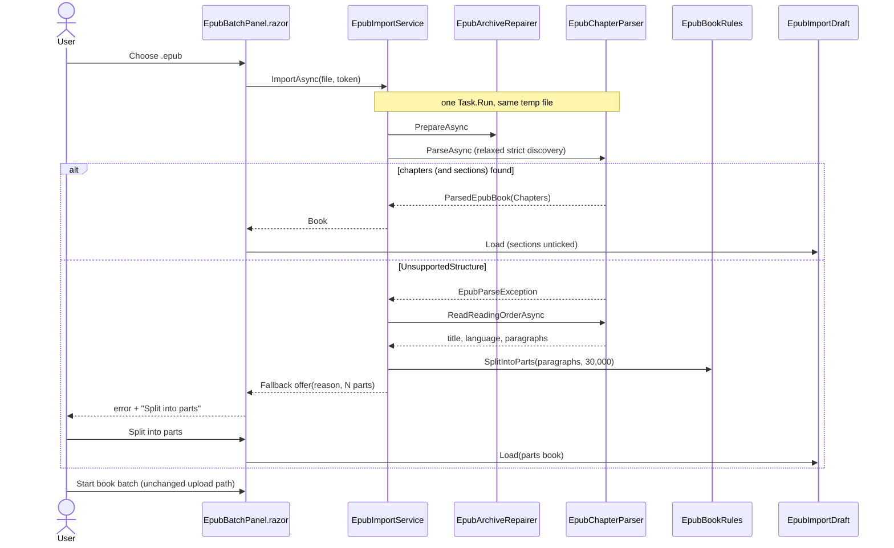

# Plan: EPUB Chapter Discovery Relaxations and No-Chapter Fallback

## Table of Contents
- [Summary](#summary)
- [Technical Approach](#technical-approach)
  - [Book model: items instead of only chapters](#book-model-items-instead-of-only-chapters)
  - [Parser discovery changes](#parser-discovery-changes)
  - [Narration extraction changes](#narration-extraction-changes)
  - [Reading-order text for the fallback](#reading-order-text-for-the-fallback)
  - [Import service: book or offer](#import-service-book-or-offer)
  - [Rules, track builder, and draft](#rules-track-builder-and-draft)
  - [Web: From EPUB panel](#web-from-epub-panel)
  - [Design principles applied](#design-principles-applied)
- [Component Breakdown](#component-breakdown)
- [Dependencies](#dependencies)
- [External / Vendor Documentation Evidence](#external--vendor-documentation-evidence)
- [Flow](#flow)
- [Risk Assessment](#risk-assessment)

## Summary
This plan extends the in-process EPUB import from `Specs/20261014103908-epub-book-batch-import` with five changes:
- `EpubChapterParser` accepts chapter-word labels, whole-document EPUB 3 links, body-anchored fragments, and `epub:type="chapter"` confirmation. It also learns named sections, footnote skipping, and label-echo removal.
- A second parser entry point reads reading-order text for a user-chosen fixed-size parts fallback.
- `EpubImportService` returns either a book or a fallback offer.
- `EpubBookRules`, `BookTrackBuilder`, `EpubImportDraft`, and `EpubBatchPanel.razor` handle three item kinds: chapter, section, and part.
- `EpubBookRules.PrimaryLanguage` normalizes `eng`/`por`/`swe`.

The worker, `POST /batches`, and the repair step do not change.

## Technical Approach

### Book model: items instead of only chapters
`WebApp/Models/EpubBook.cs`:
- `ParsedChapter(int Number, IReadOnlyList<string> Paragraphs)` gains three fields:
  - `BookItemKind Kind` (`Chapter`, `Section`, or `Part`).
  - `string? Title`, the TOC label for sections and null otherwise.
  - `int Order`, the 1-based position in book order.

  The record keeps its name so existing call sites and tests change minimally. `Number` is the chapter number for chapters, the part number for parts, and the section's ordinal among sections.
- `ParsedEpubBook(Title, Language, Chapters)` gains `BookStructure Structure` (`Chapters` or `Parts`), defaulting to `Chapters`.
- `BookSelection.Excluded` and `EpubImportDraft.Excluded`/`Expanded` hold `Order` values (FR18).
- `BookTrack(DisplayName, Text, Characters, Bytes, int? ChapterNumber)` becomes `BookTrack(DisplayName, Text, Characters, Bytes, int? ItemOrder, BookItemKind? Kind)`. Intro and outro keep null.
- `BookTrackKind` (`Intro`, `Chapter`, `Outro`) gains `Section` and `Part` for `EpubBookRules.TrackFileName`.

### Parser discovery changes
All changes stay inside `WebApp/Services/Epub/EpubChapterParser.cs`. It keeps its private helpers, archive validation, XML settings, and path normalization verbatim (AGENTS.md rule). The file header gains a line naming the Perene changes.

1. **Labels (FR1, FR2).** Replace the `NcxChapterLabel` regex with `ChapterWordLabel`: `^(?:Chapter|Cap[ií]tulo|Kapitel)\s+0*([1-9][0-9]*)(?:\s*[.:\-–—]\s*\S.*|\s+\S.*)?$`, case-insensitive. `TryParseNcxChapterNumber` tries it first. The EPUB 3 loop tries `NumericLabel` and then `ChapterWordLabel` to compute `numeric`.
2. **Semantic confirmation (FR3).** Add `FindSemanticChapter(XElement target, bool wholeDocument)`. It returns the nearest structural ancestor-or-self of the target typed `chapter`, or, for a whole-document target, the first `section`/`article` in `body` typed `chapter`.
   - The EPUB 2 loop uses it when `FindNumericBoundary` returns null. It is also used for whole-document targets when the "exactly one matching numeric heading" check fails.
   - The boundary is then that structural element for fragment targets, or the document for whole-document targets.
3. **Whole-document EPUB 3 links (FR4).** `ResolveNavigationTarget` returns `(path, null)` when `href` has no `#`; query strings are still rejected. The EPUB 3 loop mirrors the NCX whole-document branch:
   - The target is the single matching numeric heading, or the semantic chapter structure.
   - The candidate is created with `IsWholeDocumentTarget: true`.
   - EPUB 3 chapter extraction switches from `ExtractParagraphs` to the shared continuation extractor.

   Non-chapter whole-document links (Cover, Copyright…) are skipped. They no longer abort the import.
4. **Body-anchored fragments (FR5).** After resolving a fragment target, if `target.Name.LocalName is "body" or "html"`, set `fragment = null` and use the whole-document branch.
5. **Continuation stops (FR6).** Both discovery loops collect `allTargetPaths`, the resource path of every TOC entry including skipped ones. `ExtractNcxParagraphs` (renamed `ExtractWithContinuation`, shared by both loops) ends at the first spine index greater than `start` whose path is in `allTargetPaths`, instead of the next whole-document candidate.
6. **Named sections (FR7, FR8).** For an unnumbered entry, `EpubBookRules.SectionKeyword(label)` or a target-structure `epub:type` in the section set marks it as a section. The check is the same for EPUB 2 and EPUB 3, because Calibre EPUB 2 content carries EPUB 3 `epub:type` attributes.
   - Sections become candidates with `Kind = Section` and `Title = NormalizeWhitespace(label)`.
   - Sections are not used for duplicate-number checks.
   - A section with no paragraphs is dropped.
   - If no `Chapter` candidate remains, the parser throws the existing "No chapters matched…" `UnsupportedStructure`.
   - Final items are ordered by spine position of their targets, then document order, and `Order` is assigned.

### Narration extraction changes
- **Footnotes (FR9).** `ExtractNarrativeBlocks` excludes these blocks:
  - Blocks for which `IsFootnote` is true for the block or an ancestor, where `IsFootnote` means `epub:type` contains `footnote`/`endnote`/`rearnote`/`footnotes`/`endnotes`/`rearnotes`.
  - Headings (`h3`–`h6` are narrative blocks) whose following sibling elements in the same parent are all footnotes, with at least one.
- **Label echo (FR10).** After extraction, `TrimLabelEcho(paragraphs, item)` removes the first paragraph when it equals, case-insensitively and with normalized whitespace and trailing `.`/`:` ignored, one of these:
  - For a chapter: its TOC label, `N`, or `<chapter word> N`.
  - For a section: its title.

  If removing it empties a chapter, the existing "contains no narration-ready text" error applies.

### Reading-order text for the fallback
`IEpubChapterParser` gains this method:

```csharp
Task<EpubReadingText> ReadReadingOrderAsync(Stream epub, CancellationToken cancellationToken);
// EpubReadingText(string Title, string Language, IReadOnlyList<string> Paragraphs)
```

It reuses the same front half as `ParseAsync`:
- `ValidateArchive`, `BuildEntryMap`, and the encryption check.
- The container and package, through `ReadPackage`.

It then walks `metadata.SpineXhtmlPaths` and concatenates `ExtractDocumentParagraphs` with the FR9 rules, under the same `MaxBookCharacters` check. Language is the raw package language and may be empty, because no chapter inference applies. Placing it in the parser keeps every archive and XML protection in one class (NFR Security) instead of duplicating 900 lines of helpers.

`EpubBookRules.SplitIntoParts(IReadOnlyList<string> paragraphs, int targetCharacters)` is pure:
- It computes `n = ceil(total / target)` and `size = total / n`.
- It appends paragraphs in order, closing a part once its length reaches `size` (the last part takes the remainder).
- It returns `IReadOnlyList<IReadOnlyList<string>>`.

### Import service: book or offer
`EpubImportService.ImportAsync` keeps its signature and returns `EpubImportResult(ParsedEpubBook? Book, bool Repaired, EpubFallbackOffer? Fallback)`, where `EpubFallbackOffer(string Reason, ParsedEpubBook Parts)`. Exactly one of `Book` and `Fallback` is set.

Inside the existing `Task.Run`, with the same `PreparedEpub`:

```csharp
try { return new(await parser.ParseAsync(prepared.Stream, ct), prepared.Repaired, null); }
catch (EpubParseException strict) when (strict.Kind == EpubParseErrorKind.UnsupportedStructure)
{
    var text = await parser.ReadReadingOrderAsync(prepared.Stream, ct);   // other kinds still throw
    if (text.Paragraphs.Count == 0) throw new EpubParseException(UnsupportedStructure, strict.PublicMessage + " This book has no readable text.");
    var parts = EpubBookRules.SplitIntoParts(text.Paragraphs, options.FallbackPartCharacters);
    return new(null, prepared.Repaired, new(strict.PublicMessage, BuildPartsBook(text, parts)));
}
```

`EpubParserOptions` adds `FallbackPartCharacters = 30_000`. It is validated as positive and no greater than `BatchRules.MaxCharacters`. Logging follows FR20.

### Rules, track builder, and draft
- **`EpubBookRules`:**
  - `PrimaryLanguage` maps `eng`/`por`/`swe` (FR19).
  - New: `SectionKeyword(string label)` → bool, using the FR7 lists with diacritics compared literally plus the unaccented `Introducao`-style forms.
  - New: `SectionFileName(string title, ISet<string> used)`, which reuses the reference `ChapterOutputWriter.CreateSlug` algorithm (FormD, drop non-spacing marks, ASCII alphanumerics joined by `-`).
  - `TrackFileName(BookTrackKind.Part, n)` → `part-NNN.txt`.
  - `SplitIntoParts`.
  - `TrackErrors(tracks, BookStructure)`: the empty-selection message is "Include at least one part." for parts, else "Include at least one chapter." It is satisfied by any chapter, section, or part track.
- **`BookTrackBuilder`:**
  - `ChapterText` switches on `Kind`. A chapter keeps the current heading. A section uses `Title` + `.` unless the title already ends in `.`, `!`, `?`, or `…`. A part has no heading.
  - `ChapterTrack` uses the per-kind file name.
  - `Build` orders by `ItemOrder` and filters by the `Order`-keyed `Excluded` set.
  - Section names are made unique per book when the chapter tracks are rendered (the panel caches them, as today).
- **`EpubImportDraft.Load`:** initializes `Excluded` with the `Order` of every section (FR8). Parts and chapters start included.

### Web: From EPUB panel
In `WebApp/Components/EpubBatchPanel.razor`, using the existing classes and states:
- **Fallback offer (FR13).** A new `EpubFallbackOffer? offer` component field, cleared on new pick, Clear, and dispose.
  - When an import returns an offer, `parseError` is set to the reason. Under the alert, a `hint` paragraph with the FR13 sentence and a `button secondary` labelled **Split into parts** (icon `bi-scissors`) are rendered.
  - Selecting it calls `Draft.Load(new EpubImportResult(offer.Parts, repaired, null), label)` and clears `offer` and `parseError`.
  - The button is disabled while `Locked`.
- **Summary (FR14, FR15):** "N chapters · M sections · X characters" or "N parts · no chapters found · X characters".
- **Rows:**
  - The label is "Chapter N", the section title, or "Part N".
  - The checkbox `aria-label` is "Include <label>", and the preview id is `chapter-preview-<Order>`.
  - `@key` uses `Order`.
  - The heading hint shows only for chapters and sections without a voice.
- **Language label** uses the mapped primary subtag, so a book declaring `eng` shows "English (eng)".
- **`app.css`:** add a `.fallback-offer` rule (flex row, wraps on phones, `gap`) reusing existing tokens. No other style changes.

### Design principles applied
- **Single responsibility:**
  - The parser still owns every byte read from the archive, and its second method only reads text.
  - The import service decides between book and offer.
  - Pure rules (labels, slugs, splitting, languages) live in `EpubBookRules`.
  - The builder renders text.
  - The draft holds circuit state, and the panel handles workflow and rendering.
- **Open/closed:** a new language adds keyword and label entries in `EpubBookRules` without touching discovery.
- **Dependency inversion and testability:** the panel depends on `IEpubImportService`/`IBookTrackBuilder`. Parser changes are covered with `SyntheticEpubBuilder` streams, and splitting and naming with pure tests.
- **Existing patterns extended:** the `BatchRules`-style static rules, the circuit draft, the `StudioComponent` panel, the same upload path, and the xUnit tests in `WebApp.Tests/Epub/`.

## Component Breakdown

**Existing files to modify:**
- `WebApp/Services/Epub/EpubChapterParser.cs`: FR1–FR10 discovery and extraction changes, plus `ReadReadingOrderAsync`.
- `WebApp/Services/Epub/IEpubChapterParser.cs`: add `ReadReadingOrderAsync` and the `EpubReadingText` record.
- `WebApp/Services/Epub/EpubImportService.cs`: strict-then-offer flow and FR20 logging.
- `WebApp/Services/Epub/IEpubImportService.cs`: `EpubImportResult` with nullable `Book`, plus `EpubFallbackOffer`.
- `WebApp/Services/Epub/EpubParserOptions.cs`: `FallbackPartCharacters` and its validation.
- `WebApp/Services/Epub/BookTrackBuilder.cs` and `IBookTrackBuilder.cs`: per-kind headings and file names, and `Order` keys.
- `WebApp/Services/Epub/EpubImportDraft.cs`: sections excluded by default and `Order` keys.
- `WebApp/Models/EpubBook.cs`: `BookItemKind`, `BookStructure`, and the new record fields.
- `WebApp/Models/EpubBookRules.cs`: language mapping, section keywords, section slugs, part names, `SplitIntoParts`, and structure-aware `TrackErrors`.
- `WebApp/Components/EpubBatchPanel.razor`: fallback offer, per-kind rows and summary, and `Order` keys.
- `WebApp/Program.cs`: extend the options validation for `FallbackPartCharacters`.
- `WebApp/wwwroot/app.css`: `.fallback-offer`.
- `WebApp.Tests/Epub/SyntheticEpubBuilder.cs`: add `AsCalibreSplitEpub2()`, `AsWholeDocumentEpub3()`, and `AsPageListEpub2()` fixtures (synthetic text only).
- `WebApp.Tests/Epub/EpubChapterParserTests.cs`, `BookTrackBuilderTests.cs`, `EpubBookRulesTests.cs`, `EpubImportServiceTests.cs`: new and adjusted cases (see Validation).
- `README.md`: update the "Import an EPUB book" rules (accepted structures, sections, parts fallback, language codes).
- `AGENTS.md`: refresh through the init-agent skill after implementation.

**New files to create:**
- None. All behavior fits existing classes; new records live in the files listed above.

## Dependencies
- The existing .NET 10 SDK/runtime images (BCL `System.IO.Compression`, `System.Xml.Linq`, `System.Text.Normalization`). No NuGet package.
- No worker, Compose, or configuration change. `EpubParser__FallbackPartCharacters` is optional.
- Real books for manual checks only, kept outside the repo (for example under `~/PereneArchive/Books/`).

## External / Vendor Documentation Evidence
- [Threat mitigation guidance for interactive server-side rendering, Resource exhaustion](https://learn.microsoft.com/aspnet/core/blazor/security/interactive-server-side-rendering?view=aspnetcore-10.0#resource-exhaustion): "don't permit clients to allocate an unbound amount of memory", and circuit memory persists longer than a request.
  - The fallback is therefore computed only after a strict failure.
  - It is bounded by `MaxBookCharacters`.
  - It replaces rather than adds to the per-pick result.
  - It lives only in component state until accepted or discarded.
- [Manage memory in deployed server-side Blazor apps](https://learn.microsoft.com/aspnet/core/blazor/host-and-deploy/server/memory-management?view=aspnetcore-10.0#memory-usage-applied-to-blazor): app-allocated memory held by a component is the app's responsibility. The offer field is cleared on new pick, Clear, and `Dispose`.
- The ZIP, XML, and `InputFile` evidence from `Specs/20261014103908-epub-book-batch-import/Plan.md` still applies unchanged, because the fallback reader reuses the same archive and XML helpers and the same single upload.
- EPUB vocabulary (not vendor documentation): `epub:type` values `chapter`, `introduction`, `preface`, `foreword`, `prologue`, `epilogue`, `afterword`, `conclusion`, `footnote`, `endnote`, and `rearnote` come from the W3C/IDPF EPUB 3 Structural Semantics Vocabulary. These values were observed in the inspected *Press Reset* package.

## Flow



## Risk Assessment

| Risk | Evidence | Mitigation |
| --- | --- | --- |
| Relaxed rules accept a non-chapter entry as a chapter | `epub:type="chapter"` also appears on *Press Reset*'s Introduction and Epilogue | Numbered labels are still required for chapters. Unnumbered semantic sections with section types or keywords become unticked sections. Other unnumbered semantic chapters keep today's behavior. |
| The last chapter absorbs back matter through spine continuation | Today's continuation stops only at the next whole-document chapter | FR6 stops at any TOC-targeted document. A fixture includes an Acknowledgments entry after the last chapter. |
| The label echo removes real text | A chapter's first paragraph could genuinely be "1." | It is removed only on an exact match with that chapter's own label or number. A test covers non-matching first paragraphs. |
| Footnote skipping removes narrative | `epub:type="footnote"` is specific | Only the typed blocks and a heading followed solely by them are removed. A test keeps an untyped "Notes" paragraph. |
| Existing imports change output | FR9/FR10 alter text for books with echoes or footnotes | This is intended and documented. Existing parser tests must still pass unchanged, and new tests pin the changes. |
| Fallback holds a second copy of book text | Interactive Server memory | Computed only after strict failure, bounded by `MaxBookCharacters`, and cleared on new pick, Clear, or dispose. |
| Fallback Part 1 starts with copyright or contents text | Fixed-size choice | Visible in the Part 1 preview, and Part 1 can be unticked as a whole. Skipping typed front matter is recorded as a follow-up in Requirements. |
| A section slug collides with reserved names | `intro.txt`/`outro.txt` | Section slugs come from full words (`introduction`), and the reserved names plus duplicates get `-2` suffixes. A test covers this. |
| Model change ripples through the panel and tests | `ChapterNumber` → `Order` keys | `ParsedChapter` keeps its name and `Number`. The compiler finds every call site, and the full `make test` gates the change. |
